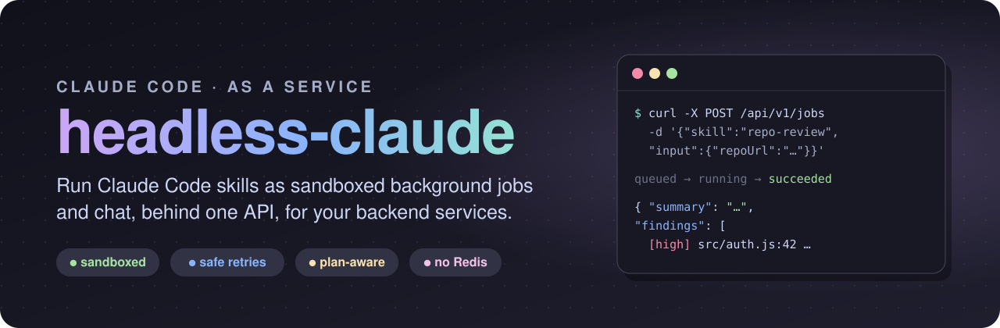
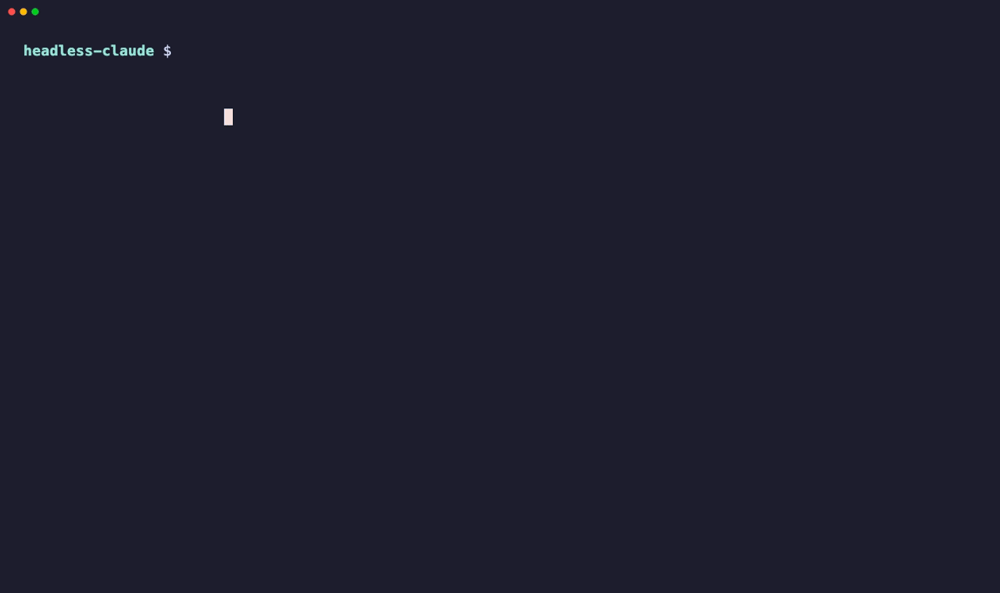
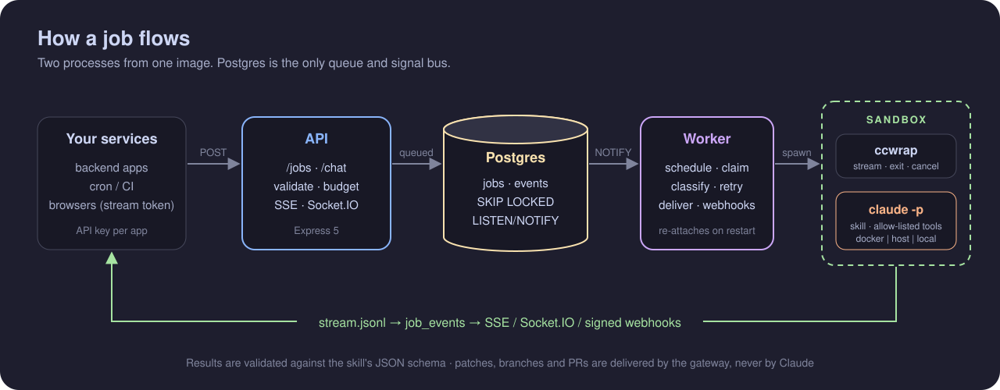
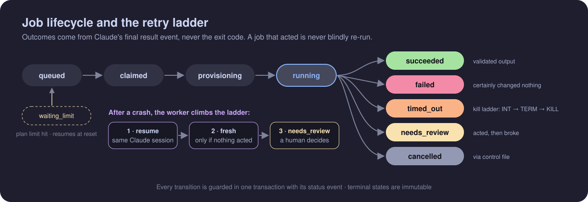

<div align="center">



<br>

**Your backend calls one API. Claude Code does the work in a sandbox. You get validated JSON back.**

[](https://github.com/mahajanankur/headless-claude/actions/workflows/ci.yml)
[](https://github.com/mahajanankur/headless-claude/stargazers)
[](#-quick-start)
[](LICENSE)
[](https://nodejs.org)
[](docs/architecture.md)
[](SECURITY.md)
[](https://code.claude.com)

[Features](#-features) · [Quick start](#-quick-start) · [How it works](#-how-it-works) · [Skills](#-skills) · [Docs](#-documentation) · [Security](SECURITY.md)

</div>

---

**Every service that wants Claude Code ends up re-writing the same wrapper.** Spawn `claude -p`, handle the login, parse the stream, survive timeouts, retry without doing things twice, keep it away from secrets, and stay inside the plan limits.

> **headless-claude does that once.** Write a skill, register it, and any backend can run it as a job or chat with it over HTTP, safely and in the background.

## 🎬 See it in action

<div align="center">



<sub>A real, unedited run on Haiku: one-command setup → a chat that remembers → a skill reviewing a real GitHub repo. Waiting time is hidden.<br>
Full quality: <a href="docs/demo/demo.mp4">demo.mp4</a> · Re-record it yourself: <code>vhs docs/demo/demo.tape</code></sub>

</div>

---

## ✨ Features

### 🧩 Skills as an API
A skill is a folder: a `manifest.json` contract (input schema, output schema, tools, limits, model) and a standard `SKILL.md`. Call it with `POST /api/v1/jobs` and get back output that has been **validated against the schema**, plus any files the skill wrote under `./out/` as downloadable artifacts.

### 💬 Chat with memory
`POST /api/v1/chat` gives you normal multi-turn conversations. Send the `sessionId` back and Claude remembers. Skill jobs can also continue the same conversation and workspace.

### 🔒 Sandboxed by construction
Each attempt runs in its own locked-down Docker container: non-root, read-only, capabilities dropped, with CPU, memory and process limits. Tools are an **explicit allow-list**. Slash commands are off. The repository's own `.claude` config never loads. Gateway secrets and git push credentials never enter the sandbox.

### 🔁 Retries that never do things twice
If an attempt crashes, the worker first **resumes the same Claude session**. It starts fresh only if nothing happened outside the workspace. Anything else is marked `needs_review` for a human. Denied tool calls don't count as acting.

### ♻️ Survives restarts
Claude runs under `ccwrap`, which writes its stream and exit record to disk. You can restart or redeploy the worker mid-job, and it re-attaches when it comes back.

### 📊 Plan-aware and budgeted
Live 5-hour and 7-day plan usage from Claude Code holds back new work before you hit the limit. If a limit is hit anyway, only that scope pauses until the reset. Each app gets a daily token budget with soft and hard caps.

### 🌿 Code changes, delivered safely
Each job gets its own clone, with the git directory hidden from Claude. The **gateway**, not Claude, delivers the result as a patch, a branch or a GitHub pull request.

### 📡 Live progress
SSE and Socket.IO streams, HMAC-signed webhooks with an SSRF guard, short-lived stream tokens for browsers, and an optional synchronous `?wait=`.

### 🔭 Optional LangFuse tracing
Turn it on during setup. You get one trace per job, with token usage per message and every tool call. No prompts or outputs are included unless a skill opts in.

> [!NOTE]
> **No Redis, no broker, no workflow engine.** Postgres is the queue (`FOR UPDATE SKIP LOCKED`) and the signal bus (`LISTEN/NOTIFY`).

---

## 🚀 Quick start

**You need:** Node.js 20+, Docker (or your own Postgres), and [Claude Code](https://code.claude.com) installed and logged in.

### 1. Set up (one command, safe to re-run)

```bash
npm ci
npm run setup
```

`setup` checks your tools, starts Postgres, runs the migrations and asks for your `claude setup-token` token. It then creates API keys, saves them to `.gateway-keys.local`, and asks whether you want LangFuse.

### 2. Start the gateway

```bash
npm run dev          # API on :4100 + worker
```

### 3. Chat

```bash
source .gateway-keys.local
curl -s -X POST localhost:4100/api/v1/chat -H "Authorization: Bearer $DEV_KEY" \
  -H "Content-Type: application/json" -d '{"message":"What is a mutex?","model":"haiku"}'
# → { "data": { "sessionId": "…", "reply": "…" } }   send the sessionId back to continue
```

### 4. Run a skill

```bash
curl -s -X POST "localhost:4100/api/v1/jobs?wait=55" -H "Authorization: Bearer $DEV_KEY" \
  -H "Content-Type: application/json" \
  -d '{"skill":"repo-review","model":"haiku","input":{"repoUrl":"https://github.com/<owner>/<repo>.git"}}'
```

```json
{ "success": true, "message": "Job finished.",
  "data": { "jobId": "…", "status": "succeeded",
            "result": { "output": { "summary": "…", "findings": [ … ] }, "artifacts": [ … ] } } }
```

> **Going to production?** See **[docs/deployment.md](docs/deployment.md)** for Docker Compose or systemd, secrets and runbooks.

---

## 🏗️ How it works

<div align="center">

</div>

<br>

| Piece | What it does |
|---|---|
| **API** (`src/api`) | Authenticates apps, validates input, checks budgets, queues jobs, serves results and live streams |
| **Postgres** | The queue, the event log and the signal bus, all in one place |
| **Worker** (`src/worker`) | Schedules and claims jobs, builds each run, classifies the outcome, retries, delivers changes and webhooks |
| **Runner** | Where Claude actually runs: `docker` (default), `host` (systemd + bubblewrap on Linux) or `local` (development only) |
| **ccwrap** | A tiny wrapper inside the sandbox. It records the stream and the exit, and handles cancel, so a job survives the worker restarting |

<div align="center">

</div>

<br>

Outcomes come from Claude's final `result` event, **never from the exit code**, because Claude Code exits `0` on SIGINT and reports some auth errors as `success`. More facts like these are in [docs/claude-code-behavior.md](docs/claude-code-behavior.md).

---

## 🧩 Skills

```
skills/repo-review/
├── manifest.json                          # contract and permissions
└── .claude/skills/repo-review/SKILL.md   # instructions Claude follows
```

| Bundled skill | What it does |
|---|---|
| `repo-review` | Clones a repository and returns structured review findings (severity, file, line, issue) |
| `chat` | Plain multi-turn conversation, behind `POST /api/v1/chat` |

- **Validated:** manifests are checked against [`src/schemas/skillManifest.schema.json`](src/schemas/skillManifest.schema.json). `npm run skills:sync` registers them, and an invalid skill is stored disabled, with the reason.
- **Locked down:** callers can't override a skill's tools, environment, permissions or credential.
- **Reviewed like code:** a manifest is a security boundary. See [`.claude/rules/skills.md`](.claude/rules/skills.md).

---

## 💸 Cost

**With your Claude subscription token, there's no per-request charge.** Jobs use your plan's allowance, and the gateway watches it and holds back new work before you run out. With an API key, Anthropic bills per token. Either way, per-app budgets, model allow-lists and turn limits cap usage. Measured numbers are in [docs/costs.md](docs/costs.md).

> [!IMPORTANT]
> Each skill chooses its credential: a Claude **subscription** OAuth token (`claude setup-token`) or an **API key**. Anthropic's terms describe subscription OAuth as intended for ordinary, individual use, and point products and services to API keys. Read the [legal and compliance page](https://code.claude.com/docs/en/legal-and-compliance) and decide what applies to you. The gateway never rotates accounts or works around plan limits.

---

## 📚 Documentation

| Doc | |
|---|---|
| [API](docs/api.md) | Every endpoint, the envelope, errors, streams and webhooks |
| [Deployment](docs/deployment.md) | Runners, secrets, Compose, systemd, operations and runbooks |
| [Configuration](docs/configuration.md) | Every config key and environment variable |
| [Architecture](docs/architecture.md) | Components, lifecycle, the retry ladder, isolation and the data model |
| [Design decisions](docs/decisions.md) | Why each choice was made |
| [Claude Code behaviour](docs/claude-code-behavior.md) | CLI behaviour the design relies on, verified with recorded fixtures |
| [Costs](docs/costs.md) | What it costs, what's measured, and how to cap it |
| [Roadmap](docs/roadmap.md) | What's done and what's next |
| [Security](SECURITY.md) | Threat model and how to report a vulnerability |

---

## 🛠️ Development

| Command | |
|---|---|
| `npm run setup` · `npm run dev` | One-time setup, then the API and worker together |
| `npm run check` | Format check, lint and every test (what CI runs) |
| `npm test` | Unit tests (no database) |
| `npm run test:integration` | API, worker and runner against `cc_gateway_test`, with a **fake `claude`**, so no real usage |
| `GW_DOCKER_TESTS=1 npm run test:integration` | Also the Docker runner tests (needs the runner images) |
| `npm run db:migrate` · `db:migrate:undo` · `db:migrate:test` | Schema migrations |
| `npm run skills:sync` · `npm run app:create` | Operations scripts |

## 🤝 Contributing

1. Read [CONTRIBUTING.md](CONTRIBUTING.md) and the backend rules in [`.claude/rules/backend.md`](.claude/rules/backend.md).
2. Write tests against the fake `claude` in `test/fixtures/fake-claude/`.
3. Run `npm run check` before you open a pull request.
4. If you change behaviour or config, update the matching doc in `docs/` in the same change.

---

## ⭐ Star history

<div align="center">

[](https://star-history.com/#mahajanankur/headless-claude&Date)

</div>

---

<div align="center">

**Write the skill once. Run it from anywhere.**

[MIT](LICENSE) © headless-claude contributors

</div>
